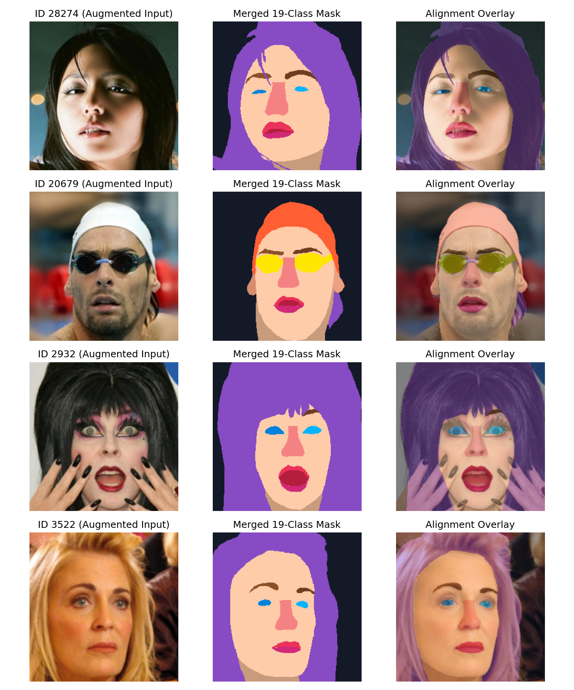
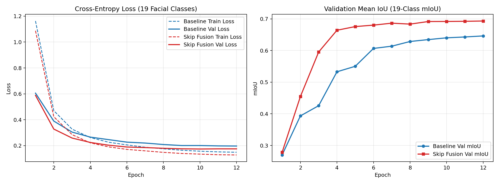
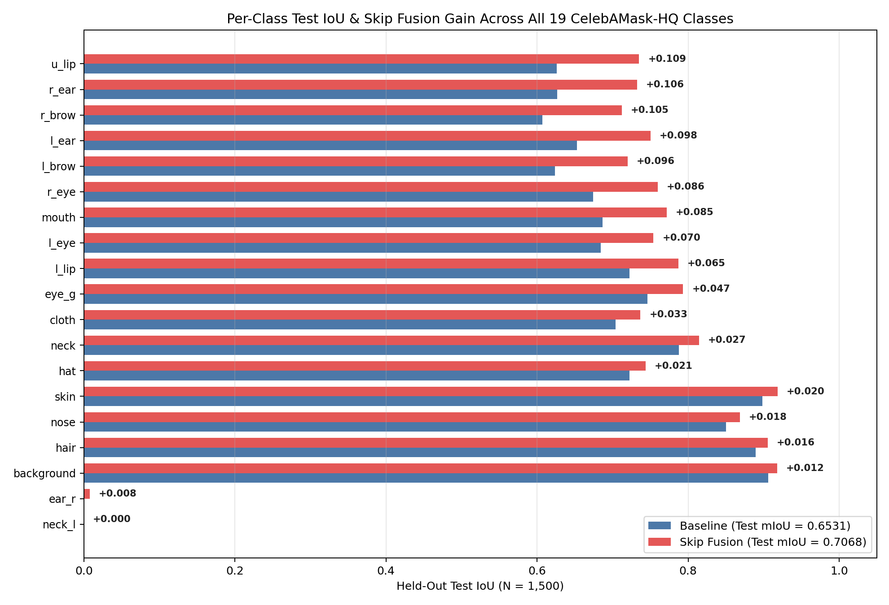
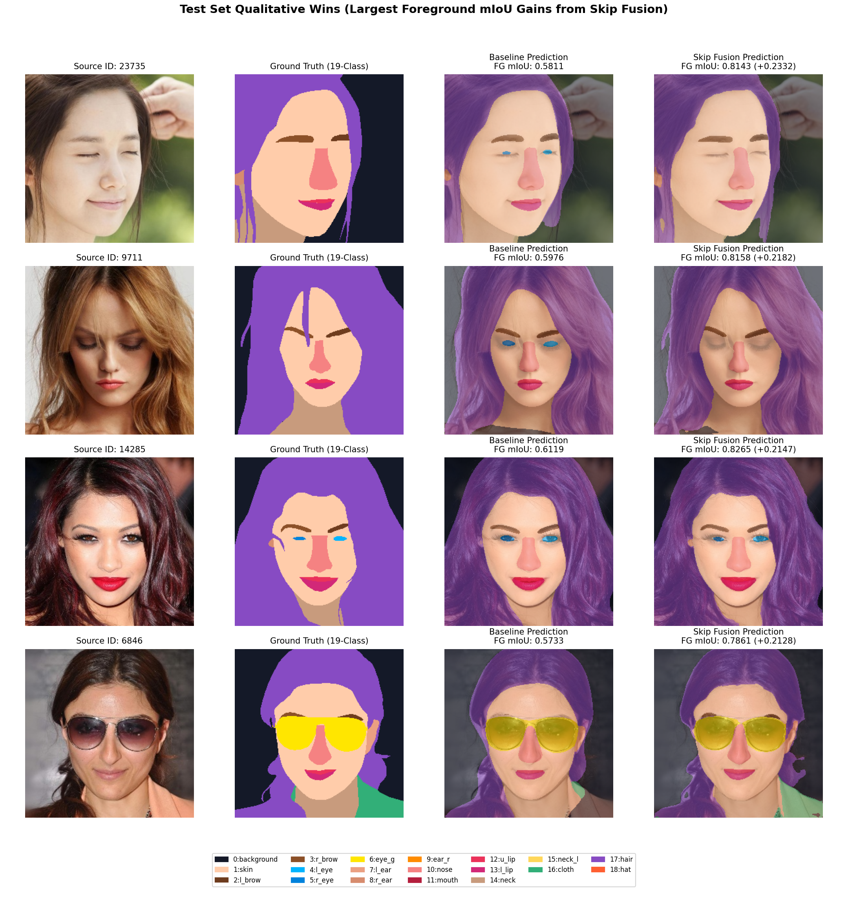
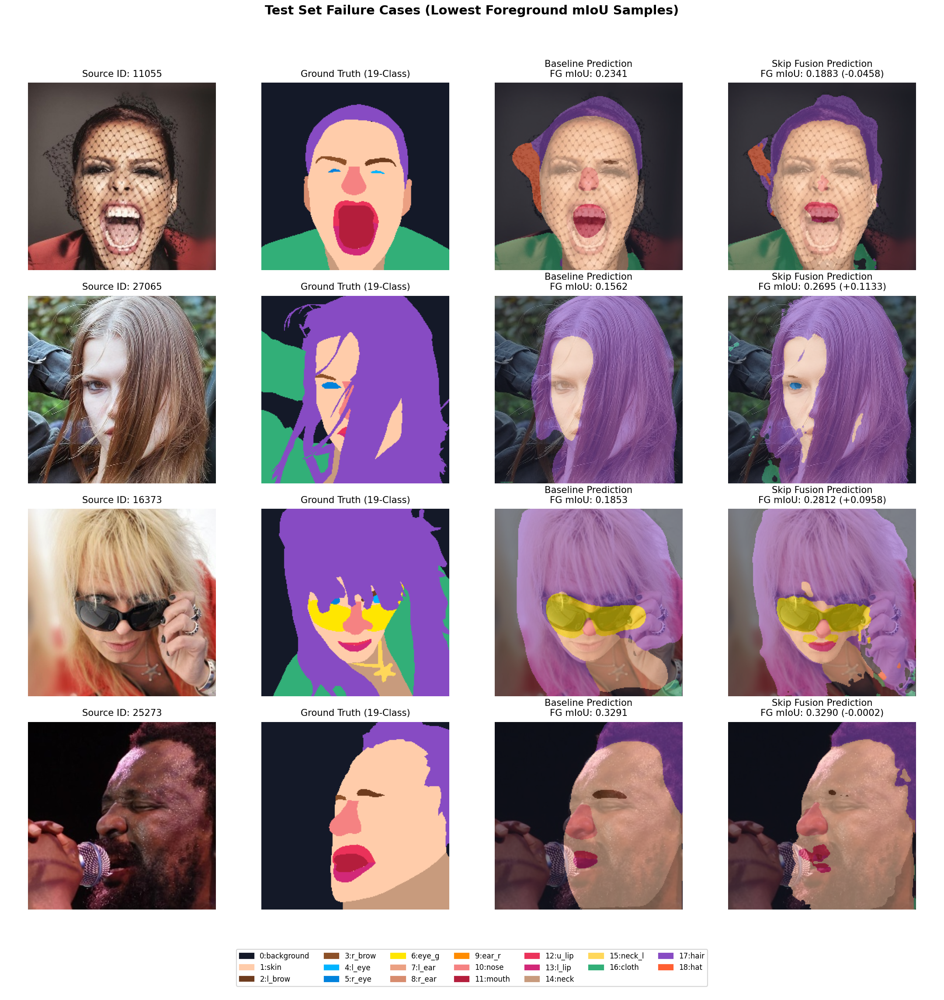

# Assignment-2B: Image Segmentation

## Multi-Scale Skip Fusion for 19-Class Facial Semantic Segmentation on CelebAMask-HQ

---

### **Name**: Apurv Shekhar 
### **Roll No**: 23115013 
### **Subject**: Advanced Computer Vision 

---

**Experimental Protocol:** Controlled Architectural Ablation (`Baseline` vs. `Skip Fusion`)  
**Dataset:** CelebAMask-HQ (7,300-Image Deterministic Subset: 5,000 Train / 800 Val / 1,500 Test)  
**Hardware & Framework:** NVIDIA Tesla T4 GPU, PyTorch (`FP32`, Resolution $256 \times 256$, Seed `42`)

---

## Abstract

Dense facial parsing requires simultaneously segmenting broad, homogeneous regions (skin, hair, clothing, background) and fine, high-frequency anatomical landmarks (eyebrows, eyes, upper and lower lips, ears, eyeglasses). Standard encoder-decoder networks that upsample directly from a stride-32 bottleneck lose high-resolution spatial cues, degrading boundary precision on small structures. In this study, we conduct a strictly controlled experiment on a leakage-free 7,300-image subset of **CelebAMask-HQ** across **19 semantic classes** (`0`–`18`). Holding the pretrained `ResNet-18` backbone, input resolution ($256 \times 256$), data augmentations, `AdamW` optimizer, cosine learning-rate schedule, random seed (`42`), and 12-epoch training budget constant, we isolate a single architectural modification: adding $1 \times 1$-projected additive **Skip Fusion** from encoder strides 16, 8, and 4 into the decoder. On the 1,500-image held-out test set, Skip Fusion increases overall mean Intersection-over-Union (mIoU) from **0.6531 to 0.7068 (+0.0537 mIoU, +8.22% relative)** while adding only **86,912 parameters (+0.68%)** and **0.20 ms** per-image inference latency ($6.09 \text{ ms} \rightarrow 6.29 \text{ ms}$ on a Tesla T4). Per-class analysis confirms that the largest gains concentrate on small, localized facial features—including `u_lip` (**+0.1088**), `r_ear` (**+0.1057**), `r_brow` (**+0.1050**), `l_ear` (**+0.0975**), and `l_brow` (**+0.0960**)—while qualitative inspection highlights both improved eyelid/contour discrimination and persistent challenges under translucent veils, hand occlusions, and extreme profile shadows.

---

## 1. Introduction & Problem Formulation

Semantic segmentation assigns a discrete semantic class label $y_{i,j} \in \{0, 1, \dots, C-1\}$ to every pixel $(i,j)$ of an input RGB image $X \in \mathbb{R}^{H \times W \times 3}$. Unlike coarse object-level segmentation, **19-class facial parsing** exhibits extreme intra-image scale variation: large classes such as `background`, `skin`, and `hair` routinely span tens of thousands of pixels, whereas fine anatomical components such as `l_brow`, `r_brow`, `u_lip`, and `l_lip` occupy thin, curved bands only a few pixels wide.

When an encoder downsamples an input image by a factor of $32\times$ (from $256 \times 256$ down to $8 \times 8$), high-frequency spatial coordinates are compressed into deep semantic channels. A plain decoder relying solely on bilinear upsampling and $3 \times 3$ convolutions must reconstruct exact facial contours from coarse $8 \times 8$ features alone. Following the skip-connection principle introduced in U-Net, we test whether fusing intermediate encoder feature maps at strides 16, 8, and 4 via lightweight $1 \times 1$ projections recovers fine facial boundaries without sacrificing real-time inference throughput.

---

## 2. Data Contract & Reproducible Split Protocol

### 2.1 Dataset & Leakage-Free Partitioning
We use the **CelebAMask-HQ** dataset (`30,000` high-resolution celebrity portraits annotated with 18 binary facial part masks at $512 \times 512$). To prevent cross-split identity or image leakage, each CelebAMask-HQ index is mapped back to its original CelebA partition using `CelebA-HQ-to-CelebA-mapping.txt`:
* **Training Pool:** `orig_idx < 162770` (24,183 images) $\rightarrow$ deterministically sampled **5,000 images** (`seed=42`).
* **Validation Pool:** `162770 <= orig_idx < 182637` (2,993 images) $\rightarrow$ deterministically sampled **800 images** (`seed=42`).
* **Held-Out Test Pool:** `orig_idx >= 182637` (2,824 images) $\rightarrow$ deterministically sampled **1,500 images** (`seed=42`).

All 7,300 selected IDs are frozen in `splits.json` prior to model training and shared identically across both runs.

### 2.2 19-Class Label Compositing & Preprocessing
Individual binary part masks are composited onto a single 19-class segmentation mask (`uint8`, `ignore_index=255`) in canonical back-to-front priority order (`0`: `background`, `1`: `skin`, `2`: `l_brow`, `3`: `r_brow`, `4`: `l_eye`, `5`: `r_eye`, `6`: `eye_g`, `7`: `l_ear`, `8`: `r_ear`, `9`: `ear_r`, `10`: `nose`, `11`: `mouth`, `12`: `u_lip`, `13`: `l_lip`, `14`: `neck`, `15`: `neck_l`, `16`: `cloth`, `17`: `hair`, `18`: `hat`). Both RGB images and merged masks are cached at $256 \times 256$ using bilinear interpolation (`INTER_LINEAR`) for images and nearest-neighbor interpolation (`INTER_NEAREST`) for integer masks.

### 2.3 Synchronized Data Augmentations
* **Training Split:**
  1. **Anatomically Consistent Horizontal Flip ($p = 0.5$):** Flips both image and mask horizontally and swaps symmetric left/right facial class IDs (`l_brow` $\leftrightarrow$ `r_brow` [$2 \leftrightarrow 3$], `l_eye` $\leftrightarrow$ `r_eye` [$4 \leftrightarrow 5$], and `l_ear` $\leftrightarrow$ `r_ear` [$7 \leftrightarrow 8$]) so semantic lateral labels remain physically valid.
  2. **Synchronized Random Resized Crop:** Crops with `scale=(0.80, 1.0)` and `ratio=(0.95, 1.05)` and resizes to $256 \times 256$ (`BILINEAR` for RGB, `NEAREST` for mask).
  3. **Channel Normalization:** Standardized using ImageNet statistics ($\mu = [0.485, 0.456, 0.406]$, $\sigma = [0.229, 0.224, 0.225]$).
* **Validation & Test Splits:** Evaluated deterministically at $256 \times 256$ with ImageNet normalization only.

*Figure 1: Visual verification of the data pipeline showing synchronized augmented RGB inputs, composited 19-class ground-truth masks, and pixel-aligned overlays.*

---

## 3. Model Architecture & Controlled Experimental Design

Both models are implemented within a unified `FaceSegNet` module (`models.py`) built atop an ImageNet-pretrained `ResNet-18` encoder (`stem` + `layer1`–`layer4`):

1. **Baseline (`baseline`, `12,754,099` parameters):** Takes the stride-32 bottleneck tensor $e_4 \in \mathbb{R}^{512 \times 8 \times 8}$ and applies four sequential $2\times$ bilinear upsampling stages followed by `Conv3x3-BatchNorm-ReLU` blocks ($512 \rightarrow 256 \rightarrow 128 \rightarrow 64 \rightarrow 32$) and a final $2\times$ upsampling classification head (`Conv3x3-BN-ReLU` + `Conv1x1` $\rightarrow 19$ logits).
2. **Single Controlled Change (`skip_fusion`, `12,841,011` parameters):** Preserves every encoder and decoder layer identically while adding three $1 \times 1$ `Conv-BatchNorm` skip projections from encoder stages $e_3$ (stride 16, 256 ch), $e_2$ (stride 8, 128 ch), and $e_1$ (stride 4, 64 ch), fused via element-wise addition into decoder stages $d_4$, $d_3$, and $d_2$, respectively.

### Fixed Comparison Budget
* **Random Seed:** `42` (`torch.backends.cudnn.deterministic = True`, `benchmark = False`)
* **Loss Function:** Pixel-wise `CrossEntropyLoss(ignore_index=255)`
* **Optimizer & Schedule:** `AdamW(lr=3e-4, weight_decay=1e-4)` with `CosineAnnealingLR(T_max=12)`
* **Batch Size & Duration:** `batch_size=16`, fixed budget of `12` epochs (~54.5s/epoch for `baseline`, ~55.2s/epoch for `skip_fusion` on Tesla T4), selecting the checkpoint with highest validation mIoU.

---

## 4. Quantitative & Latency Evaluation (Held-Out Test Set)

### 4.1 Overall Performance & Efficiency Trade-Off

| Model | Total Params | Best Val mIoU | Held-Out Test mIoU | Latency (ms/img) | Throughput (FPS) |
| :--- | :---: | :---: | :---: | :---: | :---: |
| **Baseline** | 12,754,099 | 0.6461 (Epoch 12) | 0.6531 | $6.09 \pm 0.06$ | 164.2 |
| **Skip Fusion** | 12,841,011 | **0.6932** (Epoch 12) | **0.7068** | $6.29 \pm 0.12$ | 159.1 |
| **Delta ($\Delta$)** | **+86,912 (+0.68%)** | **+0.0471** | **+0.0537 (+8.22% rel.)** | **+0.20 ms (+3.28%)** | **-5.1 FPS** |

*Latency Benchmark Protocol:* Measured on an NVIDIA Tesla T4 GPU in `FP32` precision with `batch_size=1` and input tensor `[1, 3, 256, 256]`, using 50 warmup iterations followed by 300 forward passes bracketed by `torch.cuda.synchronize()`.

*Figure 2: Training/validation Cross-Entropy loss (left) and 19-class validation mIoU progression (right) across 12 epochs under identical training budgets.*

### 4.2 Complete 19-Class Test IoU Breakdown

| ID | Class Name | Baseline IoU | Skip Fusion IoU | Delta ($\Delta$) | ID | Class Name | Baseline IoU | Skip Fusion IoU | Delta ($\Delta$) |
| :---: | :--- | :---: | :---: | :---: | :---: | :--- | :---: | :---: | :---: |
| **0** | `background` | 0.9062 | **0.9178** | +0.0116 | **10** | `nose` | 0.8502 | **0.8685** | +0.0183 |
| **1** | `skin` | 0.8982 | **0.9186** | +0.0204 | **11** | `mouth` | 0.6866 | **0.7715** | +0.0849 |
| **2** | `l_brow` | 0.6240 | **0.7200** | +0.0960 | **12** | `u_lip` | 0.6262 | **0.7350** | **+0.1088** |
| **3** | `r_brow` | 0.6073 | **0.7123** | **+0.1050** | **13** | `l_lip` | 0.7223 | **0.7872** | +0.0649 |
| **4** | `l_eye` | 0.6843 | **0.7541** | +0.0698 | **14** | `neck` | 0.7878 | **0.8143** | +0.0265 |
| **5** | `r_eye` | 0.6742 | **0.7598** | +0.0856 | **15** | `neck_l` | 0.0000 | 0.0000 | +0.0000 |
| **6** | `eye_g` | 0.7463 | **0.7933** | +0.0470 | **16** | `cloth` | 0.7038 | **0.7368** | +0.0330 |
| **7** | `l_ear` | 0.6527 | **0.7502** | +0.0975 | **17** | `hair` | 0.8896 | **0.9053** | +0.0157 |
| **8** | `r_ear` | 0.6268 | **0.7325** | **+0.1057** | **18** | `hat` | 0.7226 | **0.7437** | +0.0211 |
| **9** | `ear_r` | 0.0000 | **0.0077** | +0.0077 | | **Mean (mIoU)** | **0.6531** | **0.7068** | **+0.0537** |

### 4.3 Stratified Class Interpretation
1. **Large, Smooth Regions (`skin`, `hair`, `background`, `nose`, `neck`):** Already achieve $0.78\text{--}0.91$ IoU under the plain baseline because stride-32 features capture coarse global layout; Skip Fusion still provides consistent $+0.0116$ to $+0.0265$ boundary refinement.
2. **Fine, High-Frequency Facial Landmarks (`u_lip`, `r_ear`, `r_brow`, `l_ear`, `l_brow`, `r_eye`, `mouth`, `l_eye`, `l_lip`):** Exhibit the strongest improvements (**+0.0649 to +0.1088 IoU**). Access to stride-4 ($64 \times 64$) and stride-8 ($32 \times 32$) feature maps prevents small anatomical parts from being washed out during bottleneck compression.
3. **Ultra-Sparse, Thin Accessories (`ear_r`: `0.0077`, `neck_l`: `0.0000`):** Earrings and necklaces occupy fewer than $0.05\%$ of total dataset pixels and frequently fall below 1–2 pixels in width after downsampling to $256 \times 256$. Under unweighted Cross-Entropy loss, gradients from dominant background/skin/cloth pixels overwhelm these rare classes.

*Figure 3: Per-class held-out test IoU ($N = 1,500$) sorted by Skip Fusion improvement ($\Delta$) across all 19 CelebAMask-HQ semantic classes.*

---

## 5. Qualitative & Failure Mode Analysis

### 5.1 Largest Foreground mIoU Gains
* **Closed-Eyelid Disambiguation (`ID 23735`: $0.5811 \rightarrow 0.8143$ [$+0.2332$]; `ID 9711`: $0.5976 \rightarrow 0.8158$ [$+0.2182$]):** Relying on coarse facial geometry priors, `baseline` hallucinates open blue eyes (`l_eye`/`r_eye`) over closed eyelids. `skip_fusion` uses fine stride-4 texture cues to classify closed lids accurately as `skin` while sharpening eyebrow and lip boundaries.
* **Fine Hairline & Ear Separation (`ID 14285`: $0.6119 \rightarrow 0.8265$ [$+0.2147$]):** `skip_fusion` recovers the partially occluded left ear (`l_ear`) and cleanly separates dark hair strands framing the cheeks.
* **Eyeglass Frame & Clothing Precision (`ID 6846`: $0.5733 \rightarrow 0.7861$ [$+0.2128$]):** `skip_fusion` snaps tightly onto the thin aviator frames (`eye_g`) and corrects the collar misclassification (`neck` $\rightarrow$ `cloth`) made by `baseline`.

*Figure 4: Top four held-out test set foreground mIoU improvements achieved by Skip Fusion over Baseline, highlighting closed-eyelid accuracy and sharp brow, lip, ear, and eyeglass boundaries.*

### 5.2 Lowest Foreground mIoU Failure Cases
* **Translucent Facial Veils & Extreme Mouth Articulation (`ID 11055`: $0.2341 \rightarrow 0.1883$):** A semi-transparent black netted veil across the entire face induces severe texture ambiguity between `skin`, `hair`, and `hat`, while a wide-open screaming mouth causes confusion between interior `mouth` and `l_lip`.
* **Interleaved Hair Strands & Background Clothing (`ID 27065`: $0.1562 \rightarrow 0.2695$):** Although `skip_fusion` recovers the right eye and eyebrow missed by `baseline` ($+0.1133$), fine hair locks crossing the cheek and a dark sleeve entering from the left border remain fragmented.
* **Hand Occlusions Over Accessories (`ID 16373`: $0.1853 \rightarrow 0.2812$):** Raised fingers touching sunglasses (`eye_g`) and messy bangs cause local class bleeding around the hand-frame interface.
* **Extreme Side Profile & Microphone Shadow (`ID 25273`: $0.3291 \rightarrow 0.3290$):** A $90^{\circ}$ profile view with a microphone occluding the chin and heavy shadow across the lower neck causes both models to miss `neck` almost entirely.

*Figure 5: Lowest foreground mIoU held-out test samples illustrating failure modes caused by translucent facial netting, interleaved hair strands, hand-object occlusions, and extreme profile shadows.*

---

## 6. Limitations & Scope Boundaries

1. **Single-Seed Evaluation:** All experiments were executed under a single deterministic seed (`42`); variance across multiple random initializations and formal confidence intervals are not established.
2. **Resolution & Class-Imbalance Constraints on Rare Accessories:** Operating at $256 \times 256$ with unweighted Cross-Entropy loss fails to resolve sub-pixel classes (`ear_r`, `neck_l`). Evaluating higher input resolutions ($512 \times 512$) or class-balanced / focal / Lovasz-Softmax losses remains future work.
3. **Subsampled Training Set:** Models were trained on 5,000 of the 24,183 available CelebAMask-HQ training images; scaling to the full training partition may further improve generalization on unusual poses and occlusions.
4. **Hardware-Specific Latency:** Inference timing reflects eager-mode PyTorch `FP32` execution on a single Tesla T4 GPU rather than quantized (`FP16`/`INT8`) or TensorRT-compiled deployment engines.

---

## 7. References

1. Lee, C.-H., Liu, Z., Wu, L., & Luo, P. (2020). *MaskGAN: Towards Diverse and Interactive Facial Image Manipulation*. Proceedings of the IEEE/CVF Conference on Computer Vision and Pattern Recognition (CVPR), 5549–5558.
2. He, K., Zhang, X., Ren, S., & Sun, J. (2016). *Deep Residual Learning for Image Recognition*. Proceedings of the IEEE Conference on Computer Vision and Pattern Recognition (CVPR), 770–778.
3. Ronneberger, O., Fischer, P., & Brox, T. (2015). *U-Net: Convolutional Networks for Biomedical Image Segmentation*. Medical Image Computing and Computer-Assisted Intervention (MICCAI), 234–241.